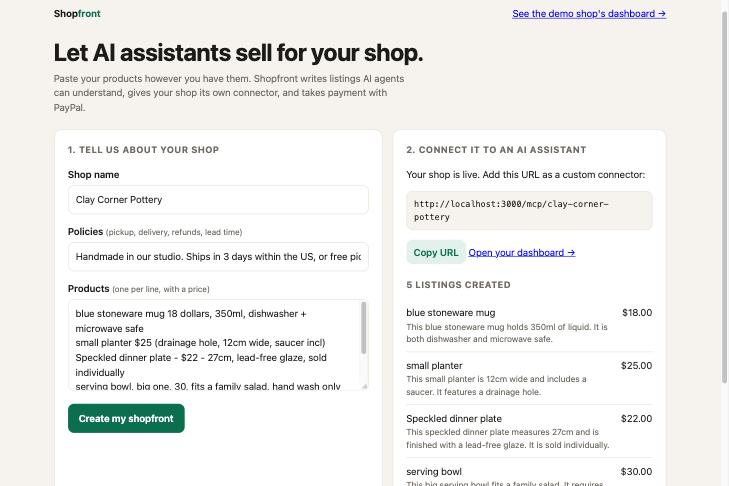
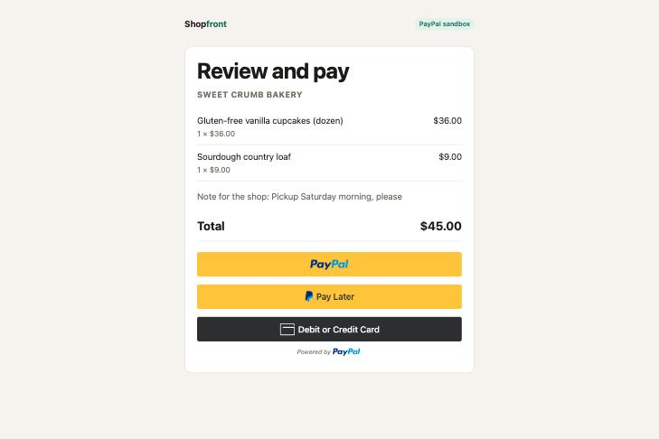
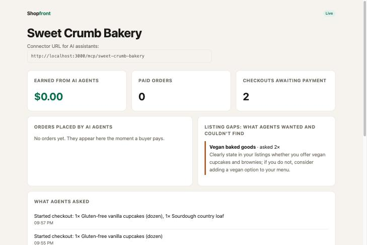
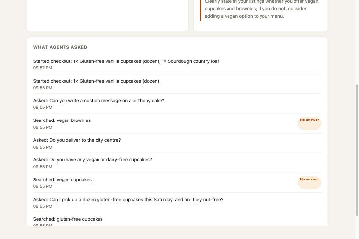

# Shopfront MCP

**Make any small shop buyable by AI agents.**

People increasingly ask an AI assistant where to buy things. A neighbourhood bakery or a solo maker has no way to show up there. Most agentic-commerce projects build the *buyer's* agent; Shopfront builds the **seller's side**.

A merchant pastes their products in any format. Shopfront:

1. **Writes agent-readable listings** with Gemini (allergens, dietary info, sizes, lead times).
2. **Gives the shop its own MCP server**, so any MCP-capable assistant can search the catalog, ask questions and start a checkout.
3. **Takes payment with PayPal** on a hosted checkout page (PayPal JS SDK, sandbox).
4. **Shows the merchant what AI agents did**: orders placed, questions asked, and the questions the listings *couldn't* answer, each with a suggested fix.

## Screenshots

| Merchant onboarding (Gemini writes the listings) | PayPal checkout link an agent hands the buyer |
|---|---|
|  |  |
| **Merchant dashboard with listing gaps** | **Every question AI agents asked** |
|  |  |

## How it works

```
AI assistant ──MCP──▶ /mcp/:shop ──▶ cart (price set by server)
                                        │
buyer ◀── checkoutUrl ──────────────────┘
  │
  ▼
/pay.html ── PayPal JS SDK: create order ▶ approve ▶ capture
  │
  ▼
POST /api/carts/:id/paid ──▶ merchant dashboard (orders, agent questions, listing gaps)
```

### MCP tools (per shop)

| Tool | What it does |
|---|---|
| `shop_info` | Shop policies and how ordering works |
| `search_products` | Keyword search over names, descriptions and attributes |
| `ask_shop` | Answers a question using only what the shop has published |
| `create_checkout` | Builds a cart from product ids and returns a PayPal checkout link |

### Where PayPal is used

- **PayPal JS SDK (Orders)** on `public/pay.html`: `actions.order.create` with itemised `purchase_units`, buyer approval, then `actions.order.capture`.
- The captured order (id, status, amount, payer) is sent to the server, which checks status and amount against its own cart before marking it paid.

### Where AI is used (Google Gemini, `gemini-flash-lite-latest`)

- Turning raw merchant notes into structured listings (`generateListings`).
- Answering agent questions strictly from shop data (`answerQuestion`).
- Grouping unanswered requests into listing fixes (`summarizeGaps`).

All three live in `lib/ai.js`. Each has a plain fallback, so the app still runs without an API key or when the Gemini free tier's rate limit is hit (the server log says when that happens).

## Run it

Requires Node 20+.

```bash
npm install
cp .env.example .env   # add GEMINI_API_KEY (optional, see above)
npm start
```

Open http://localhost:3000. A demo shop (Sweet Crumb Bakery) is preloaded:

- Onboarding: http://localhost:3000
- Dashboard: http://localhost:3000/dash.html?shop=sweet-crumb-bakery
- MCP endpoint: `http://localhost:3000/mcp/sweet-crumb-bakery` (Streamable HTTP)

To load your `.env` file: `node --env-file=.env server.js`.

### Try it with an AI assistant

Add the shop's MCP URL as a custom connector (it must be a public HTTPS URL, so use the hosted demo or a tunnel), then ask:

> Order a dozen gluten-free cupcakes for Saturday, under $40.

The assistant returns a checkout link. Pay with the **Debit or Credit Card** option using a PayPal sandbox test card; the order appears on the dashboard.

To poke at the tools directly: `npx @modelcontextprotocol/inspector`.

### Tests

```bash
npm test
```

## Project layout

```
server.js          HTTP routes: API, MCP endpoint, static pages
lib/shop.js        Pure logic: search, cart totals, capture checks (unit-tested)
lib/mcp.js         The per-shop MCP server and its four tools
lib/ai.js          Gemini calls and their fallbacks
lib/store.js       JSON-file storage
public/            index.html (onboarding), pay.html (checkout), dash.html (dashboard)
seed.json          Demo shop loaded on first run
test/              node:test unit tests
render.yaml        One-click Render deploy
```

## Deploy (Render)

`render.yaml` is included: New → Blueprint → pick this repo, then set `GEMINI_API_KEY`. The free tier's disk resets on restart, so the demo shop from `seed.json` comes back on every boot.

## Known limits

- **Capture is reported by the browser.** This build uses PayPal's public sandbox client ID (`sb`) and has no client secret, so the server cannot call PayPal to confirm a capture. It checks the reported status and amount against its own cart. With credentials, the fix is one server call to `GET /v2/checkout/orders/{id}`; the spot is marked in `server.js`.
- **No merchant login.** The dashboard URL is the access. Add auth before real use.
- **JSON-file storage** with no locking: fine for one process, not for scale.
- **Sandbox only.** No real money moves.

## License

MIT. See [LICENSE](LICENSE).
